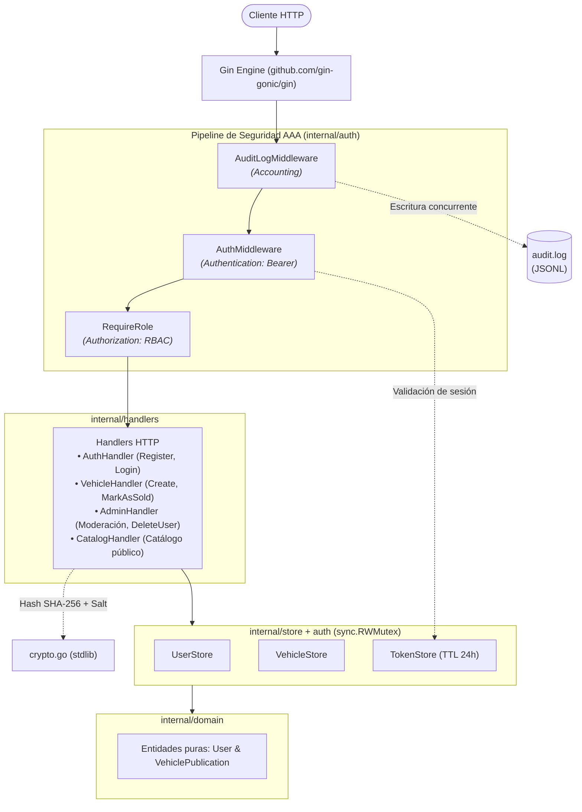
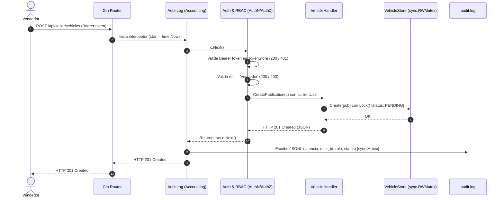

# AutoMarket - Diagramas de Arquitectura (US-14)

Diagramas oficiales requeridos para la entrega final del taller de Ciberseguridad (US-14 y US-16).

---

## 1. Diagrama A: Estructura de Componentes y Paquetes (Go)

Arquitectura por capas, bajo acoplamiento y flujo de dependencias del backend:

---

## 2. Diagrama B: Comportamiento (Secuencia AAA)

Traza de una petición protegida (`POST /api/seller/vehicles`) a través del marco de seguridad AAA:

