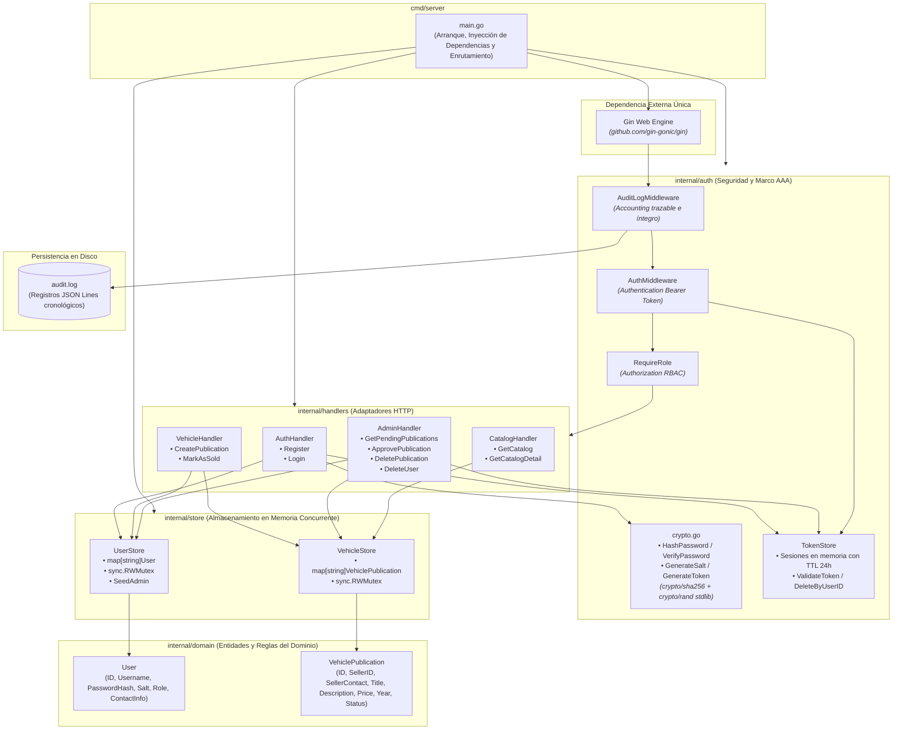
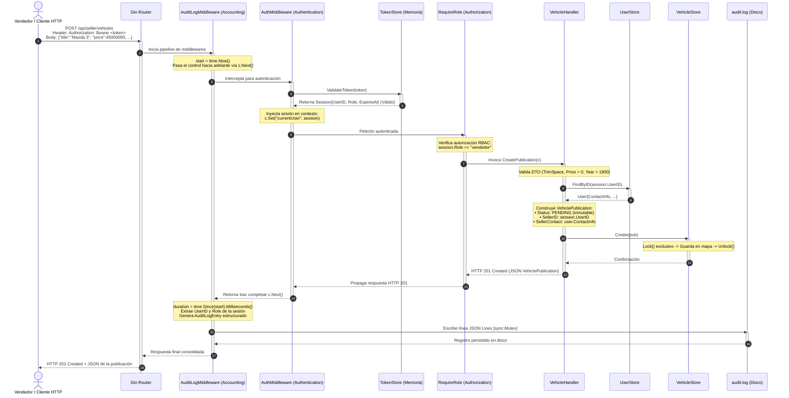

# AutoMarket - Diagramas de Arquitectura (US-14)

Este documento contiene los dos diagramas oficiales requeridos para la entrega final del taller de Ciberseguridad (US-14 y US-16):
1. **Diagrama A: Diagrama de Estructura** (Componentes y paquetes de Go).
2. **Diagrama B: Diagrama de Comportamiento** (Secuencia del flujo de seguridad AAA).

---

## 1. Diagrama A: Diagrama de Estructura (Componentes y Paquetes Go)

Ilustra la arquitectura por capas, la separación de responsabilidades, la inyección de dependencias y el bajo acoplamiento entre los paquetes del proyecto.

---

## 2. Diagrama B: Diagrama de Comportamiento (Secuencia AAA)

Ilustra la traza cronológica completa de una petición protegida (`POST /api/seller/vehicles`) atravesando el marco de seguridad AAA:
* **Accounting**: Inicia medición de latencia antes de procesar y registra la operación en `audit.log` al finalizar.
* **Authentication**: Valida la autenticidad y vigencia del token Bearer con `TokenStore`.
* **Authorization**: Verifica que el rol de la sesión sea `vendedor` mediante `RequireRole`.
* **Lógica y Almacenamiento**: Valida datos, asocia contacto del vendedor y persiste en estado `PENDING` de forma thread-safe.

