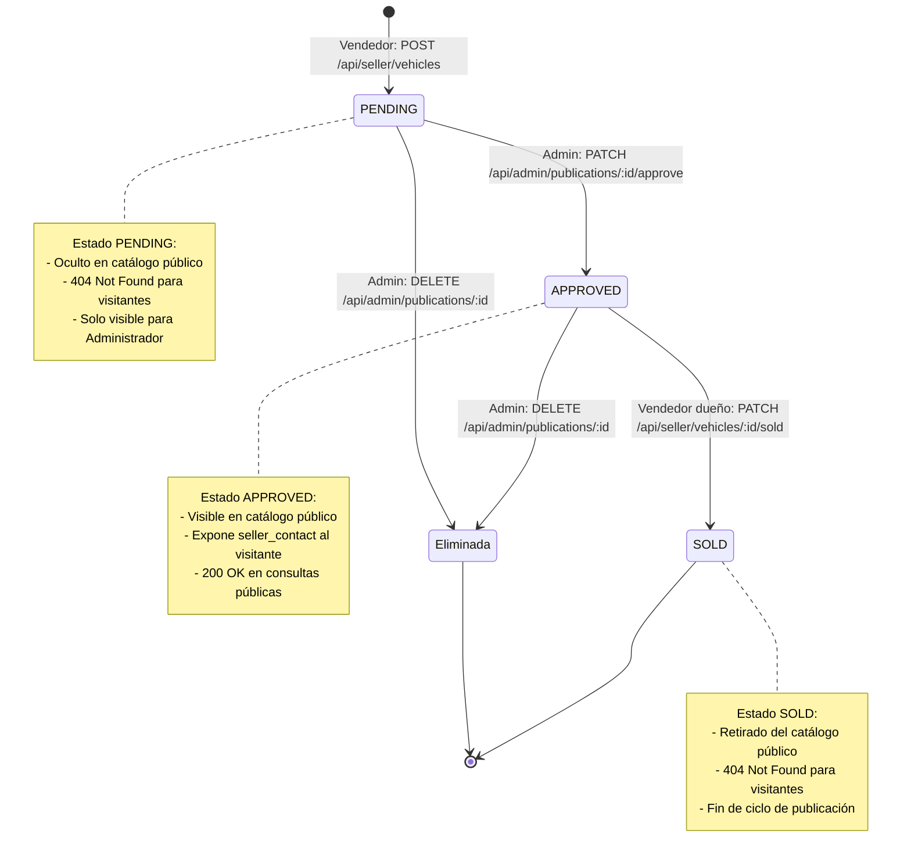

# AutoMarket - Guía Técnica de Arquitectura, Marco AAA y Sustentación

Documento técnico que detalla la arquitectura de software, decisiones de diseño, el marco de seguridad AAA (*Authentication, Authorization, Accounting*) y los flujos de las historias de usuario para el taller de Ciberseguridad.

---

## 1. Arquitectura de Software y Separación de Capas

El backend está desarrollado en **Go (stdlib pura)** utilizando **Gin** como única dependencia externa autorizada. Sigue los principios de **Clean Architecture** estructurado por responsabilidades:

```
cmd/server/main.go          ──> Composición, arranque e inyección de dependencias
docs/                       ──> Documentación técnica, enunciado, plan y ClickUp
internal/
  ├── domain/               ──> Entidades puras y reglas de negocio
  ├── store/                ──> Repositorios en memoria thread-safe (sync.RWMutex)
  ├── auth/                 ──> Módulo criptográfico stdlib, sesiones y middlewares AAA
  └── handlers/             ──> Adaptadores HTTP Gin, DTOs y respuestas
```

* **`internal/domain`**:
  * `User`: Define los roles inmutables (`RoleSeller = "vendedor"`, `RoleAdmin = "admin"`). Oculta hashes y salts en serializaciones JSON (`json:"-"`).
  * `VehiclePublication`: Define el ciclo de vida del vehículo (`PENDING`, `APPROVED`, `SOLD`).
* **`internal/store`**:
  * Repositorios desacoplados de la capa web (`UserStore` y `VehicleStore`).
  * Protegidos concurrentemente con `sync.RWMutex` para soportar múltiples lectores y exclusión mutua en escrituras.
* **`internal/auth`**:
  * Criptografía estándar sin librerías externas (sin JWT ni bcrypt).
* **`internal/handlers`**:
  * Valida DTOs, aplica saneamiento de strings (`strings.TrimSpace`) y maneja códigos HTTP semánticos.

---

## 2. Marco de Seguridad AAA (RF-01)

### A1: Authentication (Autenticación)
* **Restricción**: Prohibido el uso de JWT y bcrypt.
* **Manejo de contraseñas (`internal/auth/crypto.go`)**:
  * Cada usuario registrado genera un **Salt único** de 16 bytes aleatorios con `crypto/rand`.
  * La contraseña se almacena como el hash SHA-256 de `password + salt` con `crypto/sha256`.
  * Previene ataques basados en tablas Rainbow.
* **Manejo de sesiones (`internal/auth/token_store.go`)**:
  * Genera **tokens opacos** de 32 bytes aleatorios (64 caracteres hexadecimales) con `crypto/rand`.
  * Almacenados en `TokenStore` en memoria con TTL de 24 horas (`sessionTTL`).
  * `AuthMiddleware`: Extrae el token del header `Authorization: Bearer <token>`. Retorna `401 Unauthorized` si no existe o expiró. Si es válido, inyecta la sesión en Gin (`c.Set("currentUser", session)`).

### A2: Authorization (Autorización)
* **Control de Acceso Basado en Roles (RBAC)**:
  * Middleware `RequireRole(allowedRoles ...string)`: Comprueba que el rol de la sesión pertenezca a los roles permitidos. Responde `403 Forbidden` si no coincide.
* **Control de Acceso Horizontal (Ownership)**:
  * En `MarkAsSold`, el backend valida que `pub.SellerID == session.UserID`. Si un vendedor intenta marcar como vendida una publicación de otro vendedor, responde `403 Forbidden`.
* **Regla de integridad administrativa**:
  * En `DeleteUser`, se bloquea la autoeliminación del administrador (`session.UserID == targetID` retorna `400 Bad Request`), impidiendo que el sistema quede huérfano.

### A3: Accounting (Auditoría / Trazabilidad)
* **Implementación (`internal/auth/audit.go`)**:
  * Middleware global `AuditLogMiddleware` registrado en Gin.
  * Inicia un temporizador `start := time.Now()`, ejecuta `c.Next()` y al retorno calcula `duration_ms`.
  * Extrae el usuario autenticado (`auth.GetCurrentUser(c)`) o asigna `anonymous`/`visitor` si es ruta pública.
  * Escribe una línea estructurada en JSON Lines en `audit.log` mediante un `sync.Mutex` para garantizar concurrencia segura.
  * **Campos del log**: `timestamp`, `method`, `path`, `ip`, `user_id`, `role`, `status_code`, `duration_ms`.

---

## 3. Historias de Usuario y Ciclo de Vida del Vehículo



### HU-VIS-01 (Visitante):
* Endpoints públicos sin token: `GET /api/catalog` y `GET /api/catalog/:id`.
* Solo expone vehículos en estado `APPROVED`.
* Muestra datos del vehículo y `seller_contact`.
* **Mínima revelación**: Si el vehículo no existe, está en `PENDING` o en `SOLD`, responde exactamente `404 Not Found` uniforme para evitar enumeración.

### HU-VEN-01 (Vendedor):
* `POST /api/seller/vehicles`:
  * Protegido con rol `vendedor`.
  * Fuerza inmutablemente el estado `PENDING`.
  * Asocia `SellerID` de la sesión y `SellerContact` de la cuenta del vendedor.
  * Sanea entradas con `strings.TrimSpace` y rechaza cadenas vacías con `400 Bad Request`.
* `PATCH /api/seller/vehicles/:id/sold`:
  * Requiere ser el propietario (`403` si no).
  * Solo pasa de `APPROVED` a `SOLD` (`409 Conflict` si ya estaba vendida o aún pendiente).
  * Retira el vehículo automáticamente del catálogo público.

### HU-ADM-01 (Administrador):
* `GET /api/admin/publications/pending`: Lista publicaciones que requieren moderación.
* `PATCH /api/admin/publications/:id/approve`: Cambia el estado a `APPROVED` haciéndola visible en catálogo (`409` en re-aprobación).
* `DELETE /api/admin/publications/:id`: Borrado atómico de publicaciones.
* `DELETE /api/admin/users/:id`:
  * Elimina al usuario de `UserStore`.
  * Invalida inmediatamente todas las sesiones activas en `TokenStore` (`401` ante posteriores peticiones con sus tokens).

---

## 4. Concurrencia y Thread Safety

* **Goroutines de Gin**: Cada solicitud HTTP se procesa en una goroutine independiente.
* **`sync.RWMutex`**:
  * Lecturas concurrentes con `RLock()` / `RUnlock()` para alto rendimiento en catálogo y búsquedas.
  * Escrituras exclusivas con `Lock()` / `Unlock()` para altas, modificaciones de estado y eliminaciones.
* **Borrado atómico**:
  * Comprobación y eliminación bajo el mismo lock para evitar race conditions ante múltiples peticiones simultáneas.

---

## 5. Pruebas Automatizadas (E2E y Unitarias)

* **Script E2E (`test_flows.sh`)**:
  * Automatiza los flujos de las 3 HUs y el marco AAA mediante cURL y aserciones HTTP (200, 201, 400, 401, 403, 404, 409).
  * Valida la generación e integridad de `audit.log`.
* **Tests unitarios (`go test ./...`)**:
  * Cobertura de paquetes `auth`, `domain`, `handlers` y `store`.
