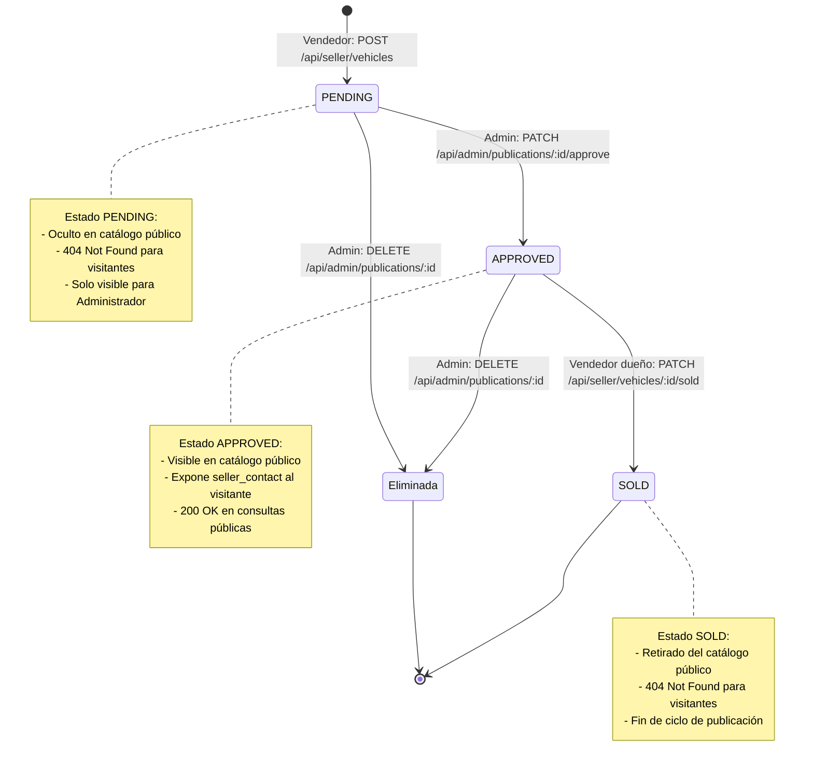

# AutoMarket - Guía Técnica de Arquitectura, Marco AAA y Sustentación

Documento técnico que detalla la arquitectura de software, decisiones de diseño, el marco de seguridad AAA (*Authentication, Authorization, Accounting*) y los flujos de las historias de usuario para el taller de Ciberseguridad.

---

## 1. Arquitectura de Software y Separación de Capas

El backend está desarrollado en **Go (stdlib pura)** utilizando **Gin** como única dependencia externa autorizada. Sigue los principios de **Clean Architecture** estructurado por responsabilidades:

```
cmd/server/main.go          ──> Composición, arranque e inyección de dependencias
docs/                       ──> Documentación técnica, enunciado, plan y ClickUp
internal/
  ├── domain/               ──> Entidades puras y reglas de negocio
  ├── store/                ──> Repositorios concurrentes con persistencia JSON stdlib (sync.RWMutex)
  ├── auth/                 ──> Módulo criptográfico stdlib, sesiones y middlewares AAA
  └── handlers/             ──> Adaptadores HTTP Gin, DTOs y respuestas
```

* **`internal/domain`**:
  * `User`: Define los roles inmutables (`RoleSeller = "vendedor"`, `RoleAdmin = "admin"`). Contiene tags JSON (`password_hash`, `salt`) para serialización persistente en archivo local. La protección contra fuga de credenciales hacia clientes HTTP se delega a la capa de Handlers mediante DTOs/proyecciones explícitas.
  * `VehiclePublication`: Define el ciclo de vida del vehículo (`PENDING`, `APPROVED`, `SOLD`).
* **`internal/store`**:
  * Repositorios desacoplados de la capa web (`UserStore`, `VehicleStore`, `TokenStore`).
  * Persistencia dual: estado en memoria (`map`) para lectura ultra-rápida respaldado en archivos JSON locales (`data/users.json`, `data/vehicles.json`) mediante la biblioteca estándar (`encoding/json`, `os`).
  * Protegidos concurrentemente con `sync.RWMutex` para soportar múltiples lectores simultáneos y exclusión mutua durante escrituras y sincronización a disco.
* **`internal/auth`**:
  * Criptografía estándar sin librerías externas (sin JWT ni bcrypt).
* **`internal/handlers`**:
  * Valida DTOs, aplica saneamiento de strings (`strings.TrimSpace`) y maneja códigos HTTP semánticos.

---

## 2. Marco de Seguridad AAA (RF-01)

### A1: Authentication (Autenticación)
* **Restricción**: Prohibido el uso de JWT y bcrypt.
* **Manejo de contraseñas (`internal/auth/crypto.go`)**:
  * Cada usuario registrado genera un **Salt único** de 16 bytes aleatorios con `crypto/rand`.
  * La contraseña se almacena como el hash SHA-256 de `password + salt` con `crypto/sha256`.
  * Previene ataques basados en tablas Rainbow.
* **Manejo de sesiones (`internal/auth/token_store.go`)**:
  * Genera **tokens opacos** de 32 bytes aleatorios (64 caracteres hexadecimales) con `crypto/rand`.
  * Almacenados en `TokenStore` en memoria con TTL de 24 horas (`sessionTTL`).
  * **Almacenamiento volátil intencional (seguridad en reposo):** Los tokens NO se persisten en disco para reducir la superficie de ataque (si alguien lee `data/` no obtiene sesiones activas) y asegurar que reiniciar el servidor invalide las sesiones huérfanas.
  * `AuthMiddleware`: Extrae el token del header `Authorization: Bearer <token>`. Retorna `401 Unauthorized` si no existe o expiró. Si es válido, inyecta la sesión en Gin (`c.Set("currentUser", session)`).
* **Inicialización de Administrador (`SetupAdmin`)**:
  * Permite crear el primer administrador si no existe en el sistema.
  * No requiere campo de contacto obligatorio (`contact_info`), dado que el administrador moderará el sistema y no publicará vehículos en el catálogo público.

### A2: Authorization (Autorización)
* **Control de Acceso Basado en Roles (RBAC)**:
  * Middleware `RequireRole(allowedRoles ...string)`: Comprueba que el rol de la sesión pertenezca a los roles permitidos. Responde `403 Forbidden` si no coincide.
* **Control de Acceso Horizontal (Ownership)**:
  * En `MarkAsSold`, el backend valida que `pub.SellerID == session.UserID`. Si un vendedor intenta marcar como vendida una publicación de otro vendedor, responde `403 Forbidden`.
* **Regla de integridad administrativa**:
  * En `DeleteUser`, se bloquea la autoeliminación del administrador (`session.UserID == targetID` retorna `400 Bad Request`), impidiendo que el sistema quede huérfano.

### A3: Accounting (Auditoría / Trazabilidad)
* **Implementación (`internal/auth/audit.go`)**:
  * Middleware global `AuditLogMiddleware` registrado en Gin.
  * Inicia un temporizador `start := time.Now()`, ejecuta `c.Next()` y al retorno calcula `duration_ms`.
  * Extrae el usuario autenticado (`auth.GetCurrentUser(c)`) o asigna `anonymous`/`visitor` si es ruta pública.
  * Escribe una línea estructurada en JSON Lines en `audit.log` mediante un `sync.Mutex` para garantizar concurrencia segura.
  * **Campos del log**: `timestamp`, `method`, `path`, `ip`, `user_id`, `role`, `status_code`, `duration_ms`.

---

## 3. Historias de Usuario y Ciclo de Vida del Vehículo



### HU-VIS-01 (Visitante):
* Endpoints públicos sin token: `GET /api/catalog` y `GET /api/catalog/:id`.
* Solo expone vehículos en estado `APPROVED`.
* Muestra datos del vehículo y `seller_contact`.
* **Mínima revelación**: Si el vehículo no existe, está en `PENDING` o en `SOLD`, responde exactamente `404 Not Found` uniforme para evitar enumeración.

### HU-VEN-01 (Vendedor):
* `POST /api/seller/vehicles`:
  * Protegido con rol `vendedor`.
  * Fuerza inmutablemente el estado `PENDING`.
  * Asocia `SellerID` de la sesión y `SellerContact` de la cuenta del vendedor.
  * Sanea entradas con `strings.TrimSpace` y rechaza cadenas vacías con `400 Bad Request`.
* `PATCH /api/seller/vehicles/:id/sold`:
  * Requiere ser el propietario (`403` si no).
  * Solo pasa de `APPROVED` a `SOLD` (`409 Conflict` si ya estaba vendida o aún pendiente).
  * Retira el vehículo automáticamente del catálogo público.

### HU-ADM-01 (Administrador):
* `GET /api/admin/publications/pending`: Lista publicaciones que requieren moderación.
* `PATCH /api/admin/publications/:id/approve`: Cambia el estado a `APPROVED` haciéndola visible en catálogo (`409` en re-aprobación).
* `DELETE /api/admin/publications/:id`: Borrado atómico de publicaciones.
* `DELETE /api/admin/users/:id`:
  * Elimina al usuario de `UserStore`.
  * Invalida inmediatamente todas las sesiones activas en `TokenStore` (`401` ante posteriores peticiones con sus tokens).

---

## 4. Persistencia en Archivos JSON y Seguridad de Datos (Desmenuzado Técnico)

### A. Estrategia Híbrida: Memoria + Vuelco a Archivos JSON (Stdlib pura)
* **Por qué no usar bases de datos externas (ORM, SQLite, PostgreSQL):**
  * Para cumplir la restricción del taller (solo Gin permitido, cero drivers externos), se implementó un motor de persistencia plano basado en `encoding/json`, `os` y `path/filepath`.
* **Mecanismo de Ciclo de Vida:**
  * **Carga inicial (`load()`):** Al iniciar el servidor (`NewUserStore`, `NewVehicleStore`), lee `data/users.json` y `data/vehicles.json`. Si el archivo no existe aún (`os.IsNotExist`), arranca el mapa vacío en memoria sin abortar la ejecución.
  * **Guardado tras mutación (`save()`):** En cada operación de escritura (`Create`, `UpdateStatus`, `Delete`, `CreateAdmin`), serializa el mapa completo con `json.MarshalIndent` y lo escribe en disco con permisos `0644`. Crea la carpeta `data/` (`0755`) si no existe.
  * **Modo en memoria (`STORAGE_MODE=memory`):** Si la variable de entorno está activa o la ruta está vacía, no toca el disco. Permite ejecutar pruebas unitarias aisladas sin efectos secundarios en el sistema de archivos.

### B. Ciberseguridad: ¿Por qué serializar `password_hash` y `salt` no fuga información?
* **El dilema de persistencia:**
  * Si la entidad `domain.User` ocultara los campos con `json:"-"`, `json.Marshal` no los guardaría en `users.json`, perdiendo los hashes y salts al apagar el servidor (los usuarios no podrían iniciar sesión tras reiniciar).
  * Por ello, `domain.User` declara `json:"password_hash"` y `json:"salt"`.
* **Concepto técnico desmenuzado: Separación de Modelo de Dominio vs DTOs de Presentación:**
  * `domain.User` representa cómo se estructuran los datos internamente y en almacenamiento duradero.
  * En la capa web/API (`internal/handlers/auth_handler.go`), el servidor **nunca** devuelve el objeto `User` directamente al cliente HTTP.
  * Se utilizan **proyecciones/DTOs explícitos** (ej. `gin.H{"id": user.ID, "username": user.Username}`).
  * **Resultado de seguridad:** El archivo en disco retiene los datos criptográficos necesarios para validar accesos, pero ningún atacante o cliente HTTP puede extraer el hash o el salt mediante peticiones a la API.

### C. Almacenamiento Efímero de Sesiones vs Datos Persistentes
* **Datos persistentes (`data/users.json`, `data/vehicles.json`):**
  * Representan el estado de negocio durable (cuentas registradas, publicaciones, estados de moderación).
* **Sesiones volátiles (`TokenStore` en RAM):**
  * Los tokens Bearer se guardan en un mapa en memoria con TTL de 24 horas.
  * **Principio de mínima exposición:** Si el servidor se apaga o sufre un compromiso del sistema de archivos local, no hay tokens de sesión activos almacenados en disco que puedan ser sustraídos para *session hijacking*.
  * Toda revocación por eliminación de usuario (`DELETE /api/admin/users/:id`) purga la sesión de memoria en tiempo real.

---

## 5. Concurrencia, Bloqueos y Thread Safety en I/O

* **Goroutines concurrentes de Gin:** Gin despacha cada petición entrante en una goroutine independiente de Go. Múltiples usuarios pueden consultar el catálogo y publicar autos a la misma milésima de segundo.
* **`sync.RWMutex` (Lector-Escritor):**
  * **Lectura compartida (`RLock()` / `RUnlock()`):** Decenas de clientes consultando `GET /api/catalog` leen concurrentemente del mapa en RAM a máxima velocidad sin competir entre sí ni hacer lecturas lentas a disco.
  * **Escritura exclusiva (`Lock()` / `Unlock()`):** Cuando se crea o modifica un usuario o vehículo, se adquiere el bloqueo exclusivo. Mientras se actualiza la memoria y se ejecuta `save()` a disco, ninguna goroutine puede leer un estado a medio escribir ni escribir en simultáneo (*race condition* evitada).
* **Integridad atómica en eliminaciones:**
  * Tanto la verificación de existencia como el borrado y la persistencia a disco se ejecutan bajo el mismo candado `Lock()`.

---

## 6. Pruebas Automatizadas (E2E y Unitarias)

* **Script E2E (`test_flows.sh`)**:
  * Automatiza los flujos de las 3 HUs y el marco AAA mediante cURL y aserciones HTTP (200, 201, 400, 401, 403, 404, 409).
  * Valida la generación e integridad de `audit.log`.
* **Tests unitarios (`go test ./...`)**:
  * Cobertura de paquetes `auth`, `domain`, `handlers` y `store` (incluyendo tests de persistencia y recarga de archivos JSON).
